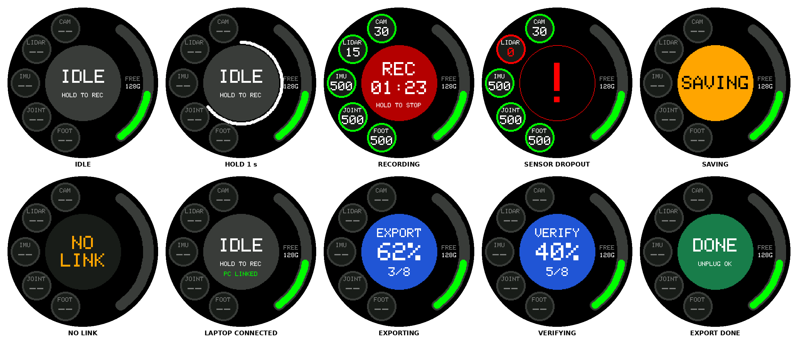
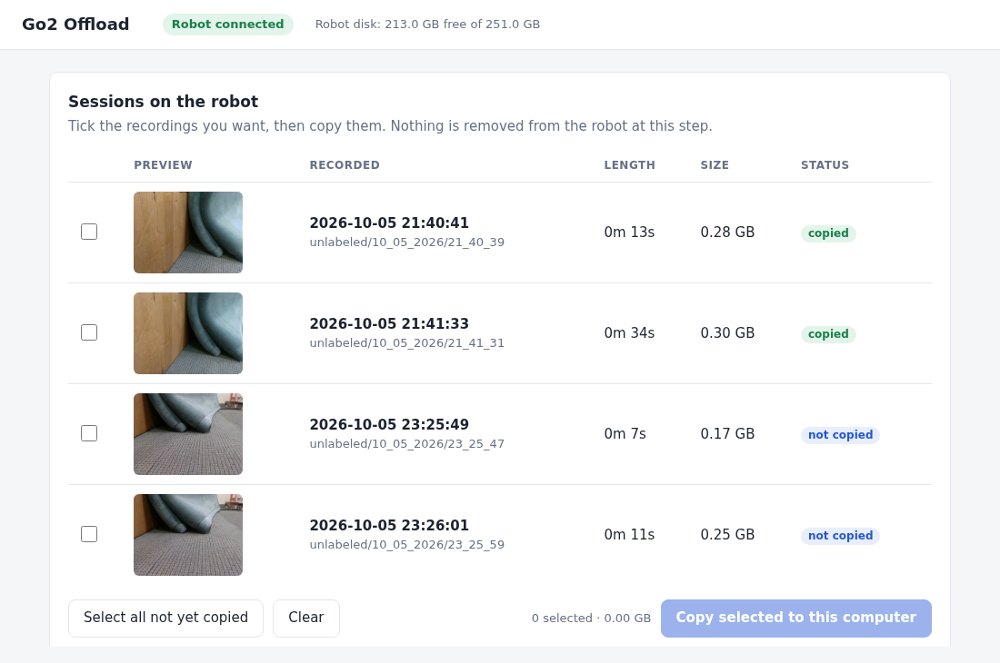

# Go2 Data Collection — User Guide

Use the round screen to record, then copy recordings to your laptop over Ethernet.



## 1. Drive the robot

**Emergency stop:** hold **L2** and press **B**. The robot goes limp and drops.

### Power on

1. Put the robot on flat ground, belly down, legs folded.
2. Press the battery button once, then press again and hold for two seconds.
   Wait about two minutes for the head light to turn steady green.
3. Switch on the controller: press its power button once, then press again
   and hold for two seconds until it beeps. Switch it off the same way; it
   beeps three times. The signal lights on its left side are all on when it
   is connected to the robot.

### Sticks

| Stick | While walking | While standing still |
|---|---|---|
| Left, forward / backward | Walk forward / backward | Raise / lower the body |
| Left, left / right | Step sideways | Rotate the body |
| Right, forward / backward | Head up / down | Head up / down |
| Right, left / right | Turn left / right | Look left / right |

### Modes

Hold the first button, then click the second.

| Action | Control |
|---|---|
| Unlock / walk | START |
| Continuous walking | START twice |
| Pose | SELECT |
| Lock standing; press again to lie down | L2 + A |
| Emergency stop | L2 + B |
| Stand up after a fall | L2 + X |
| Run | L2 + START |
| Continuous running | L2 + START twice |
| Stairs: up forwards, down backwards | RIGHT arrow + START |
| Stairs: down forwards | LEFT arrow + START |
| Endurance mode | L1 + SELECT |

### Settings

| Action | Control |
|---|---|
| Obstacle avoidance on (default) | X |
| Obstacle avoidance off | Hold Y for three seconds |
| Body height | Arrow up / down |
| Leg lift height | L1 + arrow up / down |
| Searchlight on / off | L2 + SELECT |
| Head light (default green) | Arrow left / right |

### Tricks

| Action | Control |
|---|---|
| Stretch | R2 + A |
| Shake hands | R2 + B |
| Cheer | R2 + Y |
| Punch | R1 + X |
| Jump forward | R1 + A |
| Sit | R1 + B |
| Dance 1 / Dance 2 | L1 + A / L1 + B |

Source: Unitree's [Go2 manual](https://marketing.unitree.com/article/en/Go2/User_Manual.html)
and [controller manual](https://marketing.unitree.com/article/en/Go2/Handheld_Remote_Control.html).

### Phone app

Sign in to [Unitree Go](https://www.unitree.com/mobile/app/go2/) with the lab
account and connect through the robot's hotspot. The app also has the camera
view, controller pairing and calibration.

## 2. Record

Before going out, connect your laptop and run the offload tool once (section 3).
This sets the robot's clock.

1. Long-press the screen's side button and wait for **IDLE**.
2. Check **FREE**. Recording uses about 1.3 GB per minute.
3. Hold the centre circle for one second, until the ring closes. Recording
   begins two seconds later.
4. Watch the five indicators: `CAM 30`, `LIDAR 15`, `IMU / JOINT / FOOT 500`.
   A red **!** marks a stream that has dropped or failed to save. Stop and
   record again.
5. Hold the centre again to stop. Wait for **SAVING** to return to **IDLE**
   before copying data or powering off.

## 3. Copy recordings

Once per laptop, install Python 3.8 or newer and get this repository:

```bash
git clone https://github.com/yuzhench/go2_data_collection.git
```

1. Lie the robot down and keep it powered on. Connect the laptop to the
   Ethernet port on the robot's back. Leave the laptop's Ethernet on
   automatic (DHCP).
2. In the repository folder, run:

   ```bash
   python go2_offload.py
   ```

   A browser page lists the sessions and the screen shows **PC LINKED**.
3. Select your sessions and click **Copy selected to this computer**.
   The screen shows **EXPORT**, then **VERIFY**.

   

4. Choose which copied sessions to delete from the robot.
5. Unplug the cable and stop the tool with Ctrl-C.

Files go to `Go2Data` in your home directory. To choose another folder:

```bash
python go2_offload.py --dest /path/to/folder
```

The copied files are raw recordings. Convert them with the
[recording repository](https://github.com/yuzhench/Harvard_AI_Robotics_go2_recording_system).

## 4. Upload to the lab storage

### Register (once)

Open the registration link from the lab.

- **New to the lab's data sites:** fill in the form. Use the same username and
  password you use on other lab datasets.
- **Already registered on another lab dataset:** choose
  **I've registered for another lab dataset** and enter that username and
  password. Your account is copied over; no form to fill in.

Log in at [robodog.llm-decision-making.org](https://robodog.llm-decision-making.org).
After logging in to one lab site, the others you have joined open without
logging in again; they are listed at the top of the page. Logging out of one
logs you out of all of them in that browser.

### Upload

1. Click **Choose folder** and select your `Go2Data` folder.
2. Check the list. Each recording shows its file count and size.
3. Click **Upload**. Recordings are uploaded one after another, each as one
   file and one submission.
4. Wait until every recording shows **Submitted**. Keep the page open and the
   laptop awake until then.

Notes:

- Only recordings the offload tool copied and verified are uploaded. A
  recording marked **Not verified** has to be copied again with the offload
  tool first.
- Keep the folder layout the offload tool created
  (`Go2Data/<task>/<date>/<time>/`). Recordings are found by those folders.
- Recordings you already submitted are marked and skipped, so you can choose
  the same `Go2Data` folder every time.
- If an upload stops, click **Upload** again. Finished recordings are skipped;
  the interrupted one starts over.
- Each recorded minute is about 1.3 GB to upload; use a fast connection.
- To remove a submission, click **Withdraw** next to it under
  **Your submissions**.

## 5. Power off

Press L2 + A until the robot lies down. Press the battery button once, then
press again and hold for two seconds.

## Troubleshooting

| Symptom | Action |
|---|---|
| Black screen | Long-press its side button; check its USB cable. |
| NO LINK | Wait for the robot to finish starting; check the screen's USB cable. |
| ERROR | Check the camera cable and free space, then try again. |
| Robot not connected | Check the Ethernet cable and that the laptop's Ethernet is on automatic (DHCP). |
| Copy interrupted or failed | Reconnect and copy the same sessions again. Finished files are not downloaded again. |
| Deletion failed | Refresh the list and delete again. |
